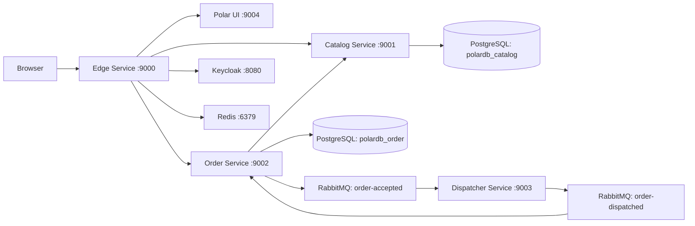

# Polar Bookshop — Edge Service

Polar Bookshop is a distributed bookshop application for browsing a catalog, placing orders, and processing dispatch events. This repository contains the public gateway and serves as the overview of the complete project.

## Project architecture



1. Visitors browse books through the gateway's `/books/**` route.
2. Keycloak provides OpenID Connect login. The gateway stores sessions in Redis and relays access tokens to backend services.
3. An authenticated user submits an order through `/orders/**`. Order Service looks up the book in Catalog Service and persists an accepted or rejected order.
4. Accepted orders produce `order-accepted` events. Dispatcher Service simulates packing and labeling, then publishes `order-dispatched`.
5. Order Service consumes dispatch events and updates the order status.

The backend uses Java 17, Spring Boot, Spring Security, PostgreSQL, and RabbitMQ. The gateway uses Spring Cloud Gateway with WebFlux; catalog persistence uses JDBC and order persistence uses R2DBC. Flyway manages database migrations. The deployment repository includes Prometheus, Grafana, Loki, Fluent Bit, and Tempo for metrics, logs, and traces. The UI is supplied by the container image configured there.

## Gateway behavior

| Route | Destination / behavior |
| --- | --- |
| `/`, `/*.css`, `/*.js`, `/favicon.ico` | UI at `http://localhost:9004` |
| `/books/**` | Catalog at `http://localhost:9001`; circuit breaker with catalog fallback |
| `/orders/**` | Orders at `http://localhost:9002` |
| `GET /user` | Current authenticated user's profile |
| `/oauth2/authorization/keycloak` | Starts login |
| `/actuator/health`, `/actuator/prometheus` | Health and metrics |

The gateway configures retries, Redis-backed rate limiting, token relay, and session persistence. Book reads and static resources are public; other application requests require authentication. Browser requests that change state must include the CSRF token.

## Run locally

Install Java 17 and Docker. Clone the related repositories as sibling directories if you want to use the commands below.

For applications running on your machine, start the backing services from the deployment repository:

```powershell
docker compose -f ../polar-deployment/docker/docker-compose.yml up -d polar-postgres polar-redis polar-rabbitmq polar-keycloak
```

The Compose setup initializes the catalog/order databases and imports the Keycloak realm. Start catalog-service, order-service, and dispatcher-service in separate terminals using `.\gradlew.bat bootRun` from each repository. Then run this service:

```powershell
.\gradlew.bat bootRun
```

The gateway listens on `http://localhost:9000`. Browsing the root page also requires the UI at port 9004; the API routes can be used without the UI. Keycloak must expose the `PolarBookshop` realm and an `edge-service` client with a callback matching `http://localhost:9000/login/oauth2/code/keycloak`.

For the full container stack, build each application image (including config-service using its own build instructions), then run `docker compose up -d` from `polar-deployment/docker`. See that repository for deployment files and environment-specific setup.

| Setting | Default |
| --- | --- |
| `CATALOG_SERVICE_URL` | `http://localhost:9001` |
| `ORDER_SERVICE_URL` | `http://localhost:9002` |
| `SPA_URL` | `http://localhost:9004` |
| `SPRING_DATA_REDIS_HOST` | `localhost` |
| `SPRING_SECURITY_OAUTH2_CLIENT_PROVIDER_KEYCLOAK_ISSUER_URI` | `http://localhost:8080/realms/PolarBookshop` |

The configured OAuth client secret is a public local demo value. Override it externally with `SPRING_SECURITY_OAUTH2_CLIENT_REGISTRATION_KEYCLOAK_CLIENT_SECRET` whenever using a real client.

## Related repositories

| Repository | Responsibility |
| --- | --- |
| [edge-service](https://github.com/Aymanhamad2002/edge-service) | Gateway, login, sessions, and full project overview |
| [catalog-service](https://github.com/Aymanhamad2002/catalog-service) | Book catalog and PostgreSQL persistence |
| [order-service](https://github.com/Aymanhamad2002/order-service) | Orders and asynchronous dispatch tracking |
| [dispatcher-service](https://github.com/Aymanhamad2002/dispatcher-service) | Event-driven packing and labeling |
| [polar-deployment](https://github.com/Aymanhamad2002/polar-deployment) | Docker Compose, Kubernetes, and observability configuration |
| [config-service](https://github.com/Aymanhamad2002/config-service) | Spring Cloud Config server |
| [config-repo](https://github.com/Aymanhamad2002/config-repo) | Shared application configuration |

## Build and test

Java 17 is configured in the Gradle toolchain. Use the included Gradle wrapper:

```powershell
.\gradlew.bat test
.\gradlew.bat bootJar
.\gradlew.bat bootBuildImage
```

On macOS/Linux, use `./gradlew` instead. Building container images requires Docker. Catalog and order tests include database integration tests; have Docker available for Testcontainers.

## Development configuration

The values in `src/main/resources/application.yml` are local development defaults. Demo credentials such as `user` / `password` are public, disposable values for local infrastructure; never reuse them for shared environments or real data.

Spring Boot allows environment variables to override YAML values without changing the file. For any shared or production environment, supply unique credentials externally through deployment configuration or a secret manager, and do not commit them.

See [Spring Boot externalized configuration](https://docs.spring.io/spring-boot/reference/features/external-config.html) and [OWASP secrets management](https://cheatsheetseries.owasp.org/cheatsheets/Secrets_Management_Cheat_Sheet.html).

